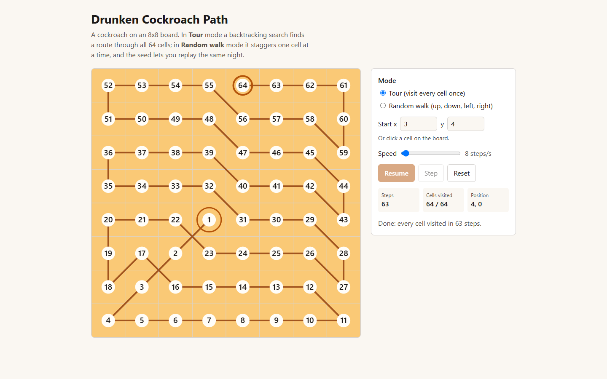
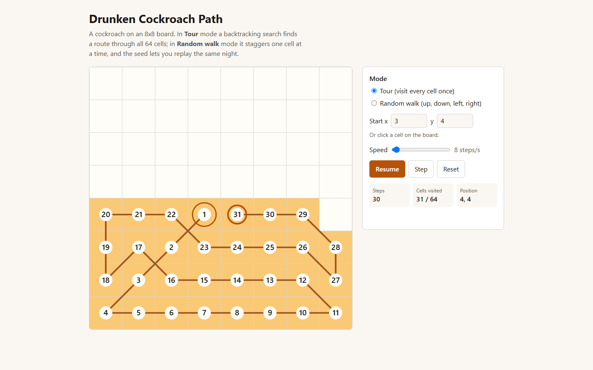
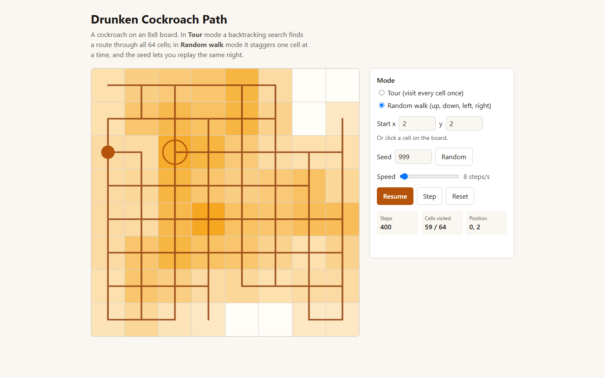
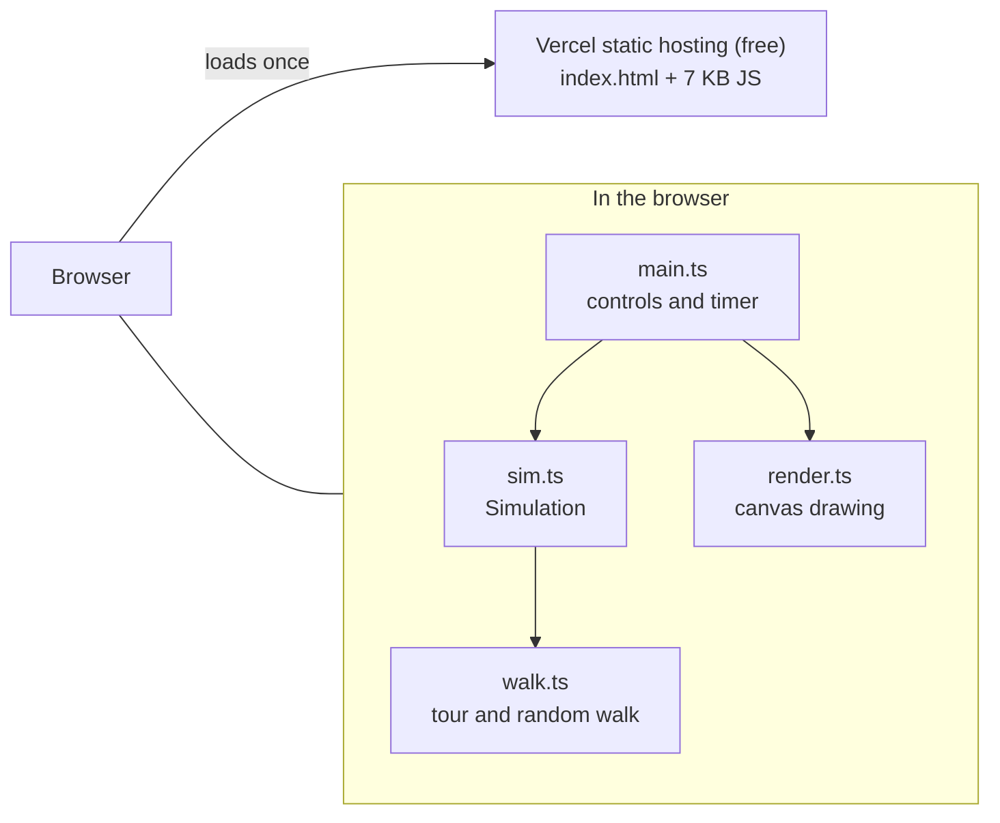
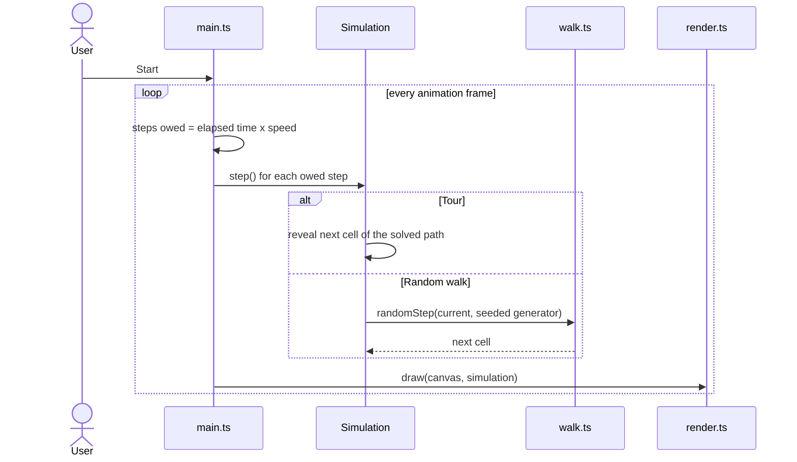

<p align="center">
  
</p>

<h1 align="center">Drunken Cockroach Path</h1>

<p align="center">
  A cockroach on an 8x8 board, animated in the browser: a backtracking search that visits every cell once, or a seeded random walk.<br>
  Pick a start cell, press Start, and watch the numbered path draw itself; the same seed always replays the same walk.
</p>

<p align="center">
  <a href="https://drunken-cockroach-path.vercel.app"><strong>Live demo</strong></a>
  &middot;
  <a href="#try-it-live">Try it</a>
  &middot;
  <a href="#how-it-works">How it works</a>
  &middot;
  <a href="#run-it-locally">Run locally</a>
</p>

<p align="center">
  
  
  
  
</p>

<p align="center">
  <a href="https://drunken-cockroach-path.vercel.app/#mode=tour&x=3&y=4">
    <picture>
      <source media="(prefers-color-scheme: dark)" srcset="docs/images/hero-dark.png">
      
    </picture>
  </a>
</p>

<p align="center"><sub>The finished tour from start cell (3, 4), 63 steps. Open it live: <a href="https://drunken-cockroach-path.vercel.app/#mode=tour&x=3&y=4">/#mode=tour&x=3&y=4</a>, then press Start.</sub></p>

<p align="center"><sub>Last updated: 2026-10-17 &middot; Live on a free tier (Vercel); no backend, no database</sub></p>

---

## Contents

- [About](#about)
- [Try it live](#try-it-live)
- [Features](#features)
- [Why it exists](#why-it-exists)
- [How it works](#how-it-works)
- [Engineering quality](#engineering-quality)
- [Run it locally](#run-it-locally)
- [Environment variables](#environment-variables)
- [Deployment](#deployment)
- [Status and roadmap](#status-and-roadmap)
- [Credits](#credits)

## About

A drunken cockroach crosses a tiled floor. Where does it go, and how long until it has touched every
tile? This project answers it two ways on an 8x8 board and lets you watch both: **Tour** finds a route
that visits all 64 tiles exactly once, and **Random walk** staggers one tile at a time in a random
direction and shows which tiles it keeps coming back to.

It started as a college graphics program in C++ (`graphics.h`, Windows only). It is now a small web
app that runs in any browser, with the original path-search algorithm ported to TypeScript, a seeded
random walk added next to it, and tests for the logic. The C++ source is kept in [`legacy/`](legacy/).

## Try it live

Open **[drunken-cockroach-path.vercel.app](https://drunken-cockroach-path.vercel.app)**. No sign-in, nothing to install.

Things to try in the first two minutes:

1. Press **Start** in Tour mode. The cockroach walks from cell (0, 0), numbering each tile; at 63 steps every tile is covered.
2. Click any cell on the board to change the start, then press Start again. All 64 start cells work, including (7, 6), where the original program's move order never finishes (see [Design decisions](#design-decisions)).
3. Switch to **Random walk**, drag **Speed** to 200 steps/s and watch the heat map fill in: darker tiles are visited more often.
4. Type a **Seed**, press Reset and Start, then Reset and Start again: the walk repeats exactly. Press **Random** for a new seed, or share the address bar, which carries the seed.

<table>
  <tr>
    <td width="50%"><p align="center"><sub>Tour, 30 steps in: the path so far, current cell ringed (<a href="#the-two-modes">the two modes</a>)</sub></p></td>
    <td width="50%"><p align="center"><sub>Random walk, seed 999, 400 steps: 59 of 64 cells touched (<a href="#the-two-modes">the two modes</a>)</sub></p></td>
  </tr>
</table>

## Features

- **Tour mode**: a backtracking search finds a path through all 64 cells and the board draws it step by step.
  - Start from any cell, by clicking it or typing x and y (0 to 7).
  - Each cell shows its step number; the start is ringed and the current cell is outlined.
  - Reports "no path" instead of hanging if a start has no tour.
- **Random walk mode**: one step up, down, left or right per tick, drawn uniformly among the moves that stay on the board.
  - Cells shade by how often they have been visited.
  - A trail of the last 250 steps shows the recent route.
- **Seeded and replayable**: a seed (0 to 4294967295) fixes every random choice, so a run can be repeated or shared as a link.
- **Playback controls**: Start, Pause and Resume, a single Step, Reset, and a speed slider from 1 to 200 steps per second.
- **Live counters**: steps taken, cells visited out of 64, and the current position.
- **Light and dark themes** that follow the system setting, a layout that works down to phone width, and labelled controls.

## Why it exists

The original (September 2024) was a first graphics program: a grid, a recursive search and `graphics.h` calls. It only ran on a Windows machine with an old graphics library, so nobody could open it. Porting it was a way to keep the idea, make it something a reviewer can open in one click, and learn what the old code actually did: the README claimed a random walk and a Knight's Tour, and the code was neither (see below).

## How it works



Everything runs on the client; there is no server, no request after the page loads and nothing stored. What happens on each tick while playing:



The speed slider sets steps per second, not steps per frame, so the pace is the same on a 60 Hz and a 144 Hz screen.

### The two modes

| | Tour | Random walk |
|---|---|---|
| Moves | 8 directions (the four sides and four diagonals) | 4 directions (up, down, left, right) |
| Choice | Backtracking search, solved once at the start | One uniformly random legal move per step |
| Ends | After 63 steps, when all 64 cells are visited | Never; stop it when you like |
| Seed | Not used (the search is deterministic) | Fixes every choice |
| Board shows | Step number on each cell | Visit count as shade, last 250 steps as a trail |

### Tech stack

| Layer | Technology |
|---|---|
| Language | TypeScript 5.9 (strict), no runtime dependencies |
| Build | Vite 6; output is one 7 KB script (3 KB gzipped), 2 KB of CSS |
| Drawing | HTML canvas, with CSS variables for the light and dark themes |
| Tests and checks | Vitest 5, ESLint 9 with typescript-eslint |
| Hosting | Vercel Hobby (free) |
| Toolchain pin | Node 22 through `mise.toml` |

### Design decisions

1. **Port to a web canvas instead of keeping `graphics.h`.** The browser runs on every machine and deploys free. Trade-off: the original C++ no longer builds from the repo root; it is kept in `legacy/` for reference.
2. **Keep the logic in `walk.ts` with no DOM.** The path search, the generator and the step rule are plain functions, so the tests run without a browser and the renderer stays thin. Trade-off: a little more wiring between modules.
3. **A seeded generator (mulberry32) instead of `Math.random`.** A run is then reproducible from three numbers (mode, start, seed), which makes the tests exact and lets a link replay a walk. Trade-off: a 32-bit generator is not cryptographic, which does not matter here.
4. **Two move orders for the tour search.** The original move order never finishes from start cell (7, 6) (over 2 million attempts without a result, measured 2026-10-17), while Warnsdorff ordering (try the neighbour with the fewest onward moves first) alone is slow from (4, 2) (about 50 seconds). The two failures do not overlap, so the search tries the original order within a budget of 300,000 attempts and falls back to Warnsdorff. All 64 starts then solve in under 40 ms (worst: 39.5 ms from (7, 6), measured 2026-10-17). Trade-off: two code paths for one result.

<details>
<summary><strong>Project structure</strong></summary>

```
index.html            page shell and controls
src/
  main.ts             controls, animation loop, URL hash
  sim.ts              Simulation: one run, step by step
  walk.ts             tour search, seeded generator, random step
  render.ts           canvas drawing
  style.css           layout and light/dark theme variables
  walk.test.ts        tests for the logic
  sim.test.ts         tests for the simulation
public/favicon.svg    tab icon
legacy/               the original C++ program (graphics.h)
docs/images/          README screenshots (taken from the live site)
mise.toml             Node version pin
vercel.json           build settings for the host
```

</details>

## Engineering quality

| Area | What is in place |
|---|---|
| Tests | 20 unit tests in 2 files, all passing on 2026-10-17. They cover: a tour exists from all 64 starts and visits every cell once with legal moves; the 7,6 case under each move order; the generator (same seed same sequence, range); the random walk (reproducible, legal moves only, never leaves the board, works from a corner); the simulation (reveal, finish, replay). |
| Browser check | A Playwright script drove the production build and the live site in Chrome on 2026-10-17: tour to 63 steps from two starts, step button, seed replay (same seed same position after 400 steps, different seed different), click-to-set-start, no page errors, no horizontal scroll at 375 px. |
| Lint and types | ESLint 9 and `tsc --noEmit` (strict) clean; both run in `npm run build` and `npm run check`. |
| Dependencies | No runtime dependencies. `npm audit`: 0 vulnerabilities on 2026-10-17. |
| Security | A static page: no input goes to a server. The seed and start cell are read from the URL hash, parsed as numbers and clamped to their ranges. |
| CI | None yet (see Known limitations). |

Run them:

```bash
npm run lint     # ESLint
npm test         # Vitest, 20 tests
npm run build    # type-check and production build into dist/
npm run check    # all three
```

## Run it locally

Works on Windows (Git Bash), macOS and Linux. You need **Node 22**, pinned in `mise.toml` (install [mise](https://mise.jdx.dev) and it picks the version up, or install Node 22 yourself); npm comes with Node. There is nothing else to install: no database, no keys.

```bash
git clone https://github.com/A-RYAN-1/drunken-cockroach-path.git
cd drunken-cockroach-path
mise install          # skip if you already have Node 22
npm ci
npm run dev
```

It is ready when this returns `200`:

```bash
curl -s -o /dev/null -w "%{http_code}\n" http://localhost:5173/
```

Open http://localhost:5173. To serve the production build instead: `npm run build && npm run preview` (port 4173).

## Environment variables

None. The app reads no configuration at build or run time, so there is no `.env` file and no `.env.example`.

## Deployment

The whole app is a static site on **Vercel Hobby (free)**, project `drunken-cockroach-path`, at https://drunken-cockroach-path.vercel.app.

| Part | Host | Deploys | Variables the host needs |
|---|---|---|---|
| Static site (`dist/`) | Vercel | `vercel deploy --prod` from this folder | none |

Settings live in `vercel.json` (Vite framework, `npm run build`, output `dist`). Deploys are done with the CLI for now; the project is not yet linked to GitHub, so a push does not redeploy it.

Free-tier limits a visitor notices (checked 2026-10-17): none; it is static files, there is no sleep or cold start.

<details>
<summary><strong>Recreate the deploy from nothing</strong></summary>

1. Install the Vercel CLI and sign in (`vercel login`).
2. From the repo root run `vercel deploy --prod --yes`. Vercel detects Vite from `vercel.json`; no variables are needed.
3. Open the printed URL and press Start.

</details>

## Status and roadmap

**Reached:** deployed free and checked on the live URL on 2026-10-17 (tour, random walk, seed replay, click-to-set-start). Runs locally on Windows with Node 22 (`npm run check` passes).

**Known limitations**

- The board is fixed at 8x8; the logic takes a size, the page does not offer one.
- Tour mode ignores the seed: the search is deterministic, so there is one route per start cell.
- No CI workflow yet, so the checks run on the developer's machine only.
- The page was checked in Chrome only.

**Planned**

- [ ] Link the Vercel project to GitHub so a push to `main` redeploys.
- [ ] GitHub Actions workflow running `npm run check` on every push.
- [ ] A board-size control and a "steps until every cell is covered" readout for the random walk.
- [ ] Measure Lighthouse performance and accessibility and record the numbers here.

## Credits

Built by [Aryan Deshmukh](https://github.com/A-RYAN-1): the original C++ program (2024) and the web port, tests and deployment (2026). No co-authors.
